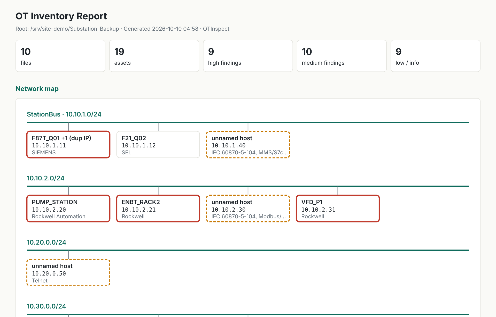
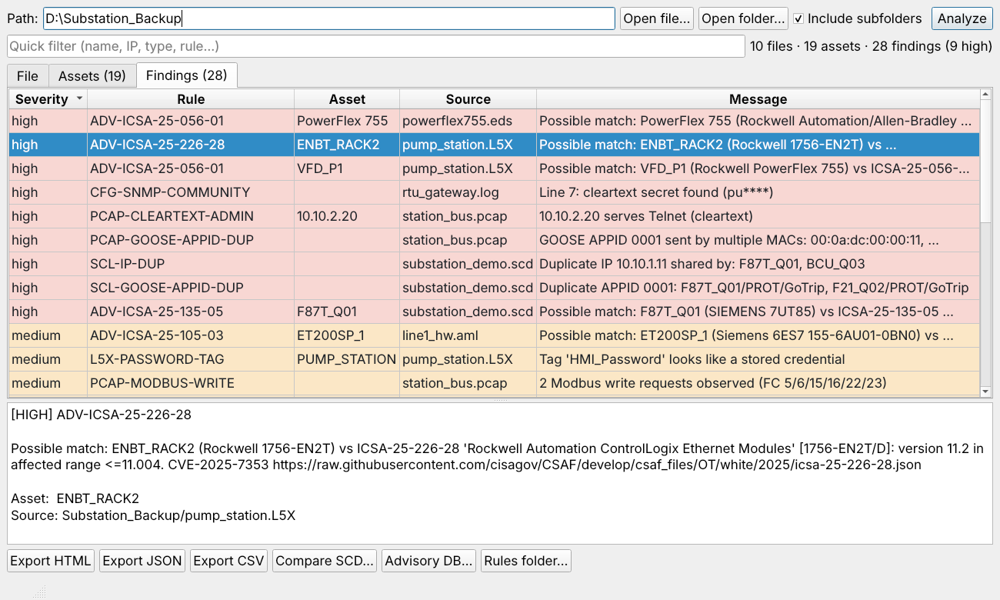
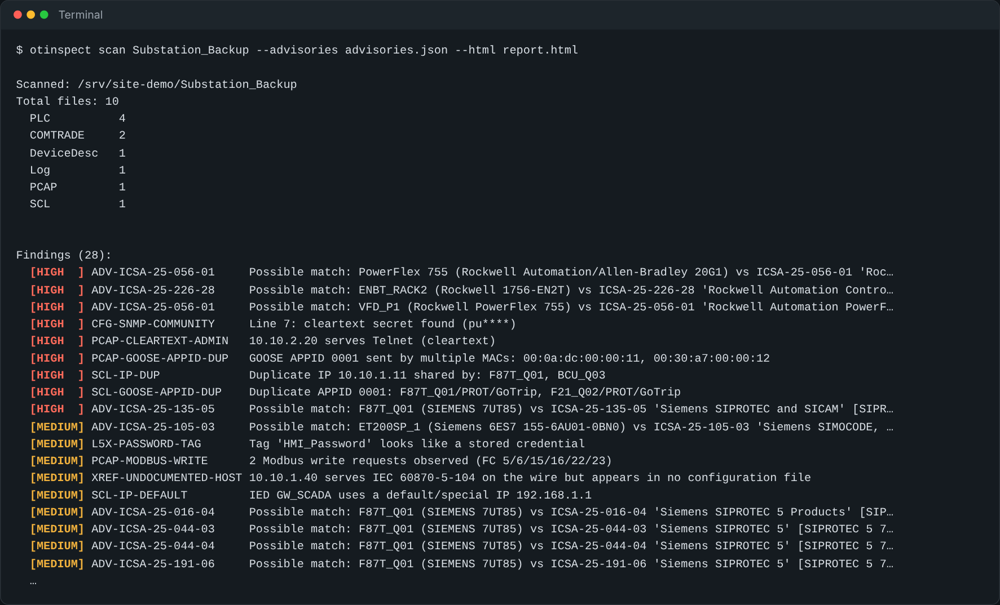
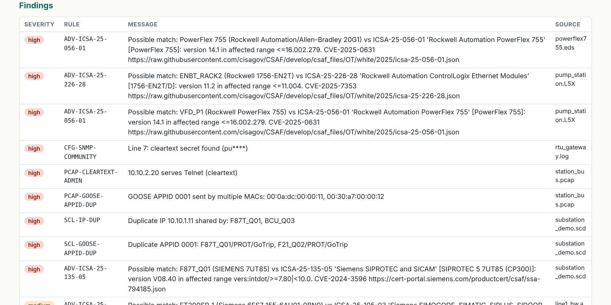
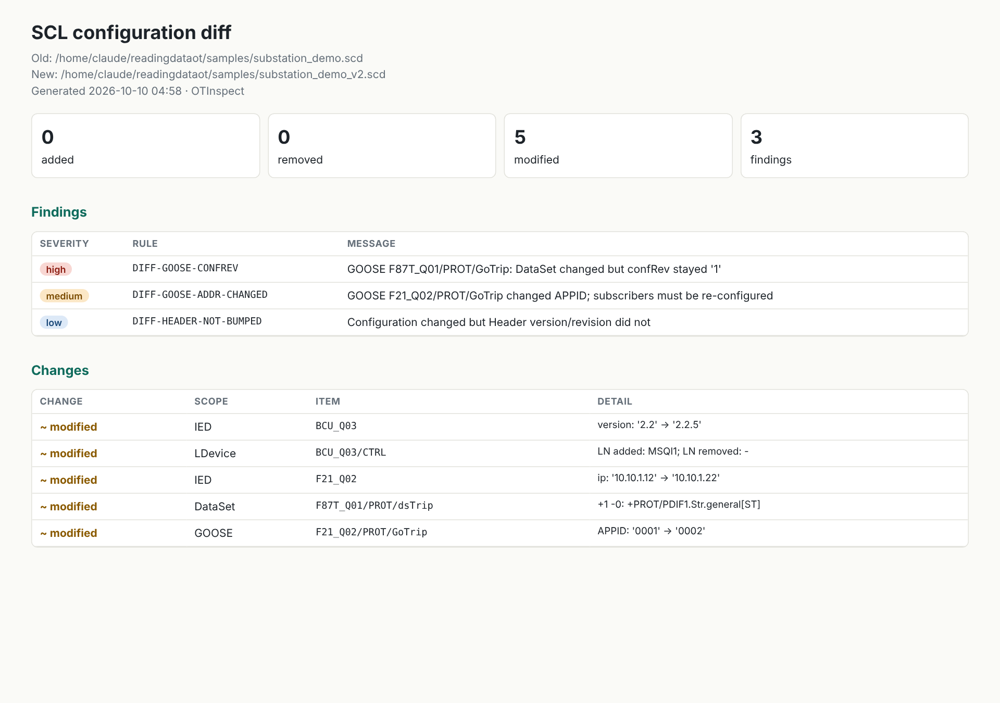
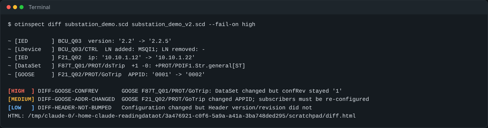
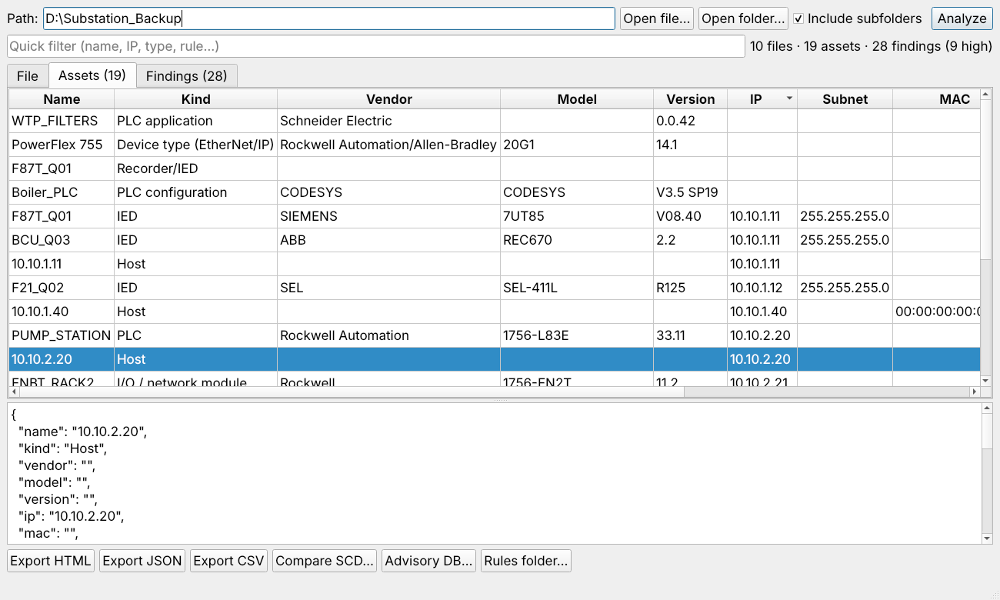
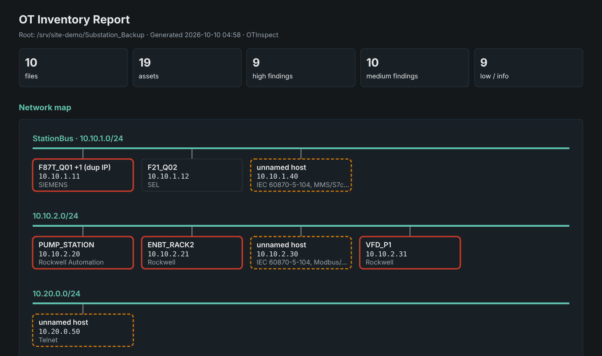
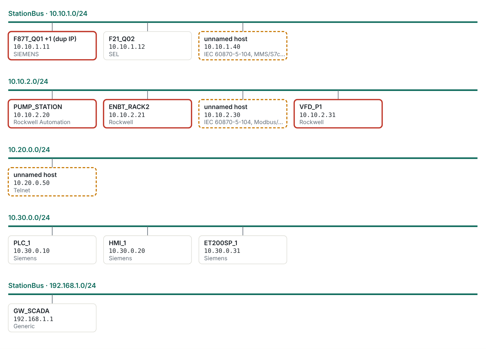

# OTInspect (ReadingDataOT)

File inventory and analysis for OT/ICS environments. Point it at a folder (a substation backup, an engineering project, a contractor's share drive…) and it tells you **what is in there, which devices it describes, and which configuration risks it can see**.

It only **reads files**. It never connects to devices.

> **Status: beta.** Tested on synthetic samples, fuzzed and hostile inputs, Windows and Linux. Real-world files from more vendors are the next validation step; please open an issue if a file is misidentified or parsed wrongly.



## Screenshots

| Desktop app | Command line |
|---|---|
|  |  |
| *Findings sorted by severity, with details for the selected row* | *Scan summary and findings in a terminal* |

<details>
<summary>More screenshots: findings table, SCD diff, asset inventory, dark mode</summary>

**Findings in the HTML report**, including offline advisory matches



**SCD diff** between two revisions of a substation configuration





**Asset inventory** in the desktop app



**Dark mode** (follows the system setting)



</details>

All screenshots use the fabricated data in `samples/`.

## Download (Windows)

Get `OTInspect-<version>-windows-x64.zip` from the [Releases](https://github.com/lindseynguyen/ReadingDataOT/releases) page. It contains two portable executables, no installation or Python required:

- `OTInspect.exe`: graphical interface (drag a folder onto the window)
- `otinspect-cli.exe`: command line, for scripts and scheduled checks

Verify the download with `SHA256SUMS.txt`. Windows SmartScreen may warn because the executables are not code-signed; choose *More info → Run anyway* only if the checksum matches.

## What it understands

| Area | Formats | What you get |
|---|---|---|
| **IEC 61850** | SCD, ICD, CID, IID, SSD, SED | IEDs (vendor, model, configVersion, IP/subnet/gateway/MAC), LDevice / LN0 / LN, GOOSE & SV (APPID, MAC, VLAN, DataSet), ReportControl, voltage levels and bays |
| **Disturbance records** | COMTRADE `.cfg` + `.dat/.hdr/.inf` (C37.111-1991/1999/2013) | Station, recording device, analog/digital channels with units and CT/VT ratios, sample rates, start/trigger time, duration, `.dat` size check |
| **Network captures** | PCAP, PCAPNG (pure Python) | L2 protocols (GOOSE, SV, PROFINET, EtherCAT, PTP, LLDP), IP-based OT protocols (MMS/S7comm, IEC 104, Modbus/TCP, DNP3, EtherNet/IP, OPC UA, BACnet, FINS, CODESYS…), VLANs, GOOSE streams with gocbRef, host inventory, top conversations, Modbus function codes |
| **PLC (Rockwell)** | `.L5X`, `.L5K` | Controller, processor, firmware, I/O and network modules with IPs, programs/routines/tags, AOIs, tasks |
| **Device descriptions** | GSDML, EDS, ESI, GSD | Vendor, product, order number, hardware/software release |
| **Logs / configs** | text logs, `.cfg`, `.ini`, CSV… | error/warning/alarm/auth counts, time range, top IPs, cleartext passwords / SNMP communities / private keys (masked) |
| **Firmware / binaries** | BIN, HEX, SREC, ELF, SquashFS, uImage… | per-block entropy, embedded signatures, interesting strings, Intel HEX address range |
| **Archives** | ZIP, Siemens TIA `.zapXX` | members identified in place (no extraction), zip-bomb and path-traversal guards |
| **Identified only** | Siemens TIA/STEP 7, Rockwell `.ACD`, Schneider, CODESYS, ABB PCM600, WinCC, FactoryTalk, EVTX, OPC UA NodeSet, PLCopen XML | category and description |

| **Engineering exports** | AutomationML / CAEX `.aml` (Siemens TIA hardware export), Schneider `.xef`, PLCopen XML | Devices with order numbers, firmware and IPs; application/project info, POUs and sections by language, tasks, variables |

Supported files inside ZIP archives (contractor handover packages, TIA `.zapXX`) are parsed in place.

Identification uses magic bytes, content (XML namespaces, COMTRADE header layout) and extensions; `python-magic` is not required.

## Risk rules

- **SCL**: duplicate IPs, duplicate GOOSE/SV APPID or destination MAC, default/special IPs, gateway outside subnet, GOOSE without VLAN, control blocks without an address, IEC 62351-6 reminder
- **PCAP**: Telnet/FTP/TFTP/HTTP/VNC servers, Modbus write and diagnostic requests, GOOSE APPID sent by several MACs, untagged GOOSE
- **L5X**: credential-like tags, mostly Read/Write external tag access, no source protection, no FactoryTalk Security binding
- **Text**: cleartext passwords, SNMP `public`/`private`, private keys
- **Firmware**: passwd/shadow content, embedded PEM blocks
- **Cross-reference**: hosts serving OT protocols in a capture that appear in **no** configuration file (`XREF-UNDOCUMENTED-HOST`)
- **XEF / PLCopen**: credential-like variables
- **Your own rules** in YAML/JSON: site baselines, approved vendors, minimum firmware, forbidden protocols. See [docs/rules.md](docs/rules.md)
- **Advisories (offline)**: assets matched against CISA ICS advisories imported from CSAF 2.0 (vendor + product + version range), reported as *possible* matches to verify

## SCD diff

Compare two revisions of a substation configuration, typically before accepting an integrator's update:

```bash
otinspect diff old.scd new.scd --html diff.html --fail-on high
```

It lists added/removed/modified IEDs, addresses, logical devices and nodes, DataSets and GOOSE/SV control blocks, and flags:

- `DIFF-GOOSE-CONFREV` / `DIFF-SV-CONFREV`: DataSet changed but `confRev` was not incremented, so subscribers may map the wrong signals
- `DIFF-*-ADDR-CHANGED`: APPID, destination MAC or VLAN changed, so subscribers must be re-configured
- `DIFF-*-REMOVED`: a publisher disappeared
- `DIFF-HEADER-NOT-BUMPED`: content changed but the SCL Header version/revision did not

## Network map



The HTML report draws every asset with an IP, grouped by SCL SubNetwork or /24. Devices with high findings have a red border, duplicate IPs are marked, and hosts that appear only in captures (undocumented) have a dashed orange border.

## Install from source

```bash
git clone https://github.com/lindseynguyen/ReadingDataOT.git
cd ReadingDataOT
pip install ".[gui]"        # or: pip install -r requirements.txt
```

Python 3.9+ is required. PyQt5 is needed only for the GUI.

## Usage

```bash
# GUI
otinspect gui                   # or: python data-kiosk.py

# Scan
otinspect scan D:\Substation_Backup --html report.html --json report.json --csv out\
otinspect scan ./project --rules site_rules.yaml --fail-on high   # exit code 2 on any high finding

# Compare two SCD revisions
otinspect diff old.scd new.scd --html diff.html

# Build the offline advisory DB (on a connected machine), then use it anywhere
git clone --depth 1 https://github.com/cisagov/CSAF
otinspect advisories import CSAF/csaf_files/OT/white -o advisories.json
otinspect scan D:\Backup --advisories advisories.json
```

With the Windows release, replace `otinspect` with `otinspect-cli.exe`.

Try it on the bundled synthetic data:

```bash
python -m otinspect scan samples --html demo.html
```

`samples/make_samples.py` regenerates the samples (including a second SCD revision for `diff`). All sample data is fabricated.

## Reports

- **HTML**: self-contained and works offline; print to PDF from any browser. Sections: network map, assets, findings, GOOSE, observed protocols, COMTRADE records, file categories, full file list with SHA-256.
- **JSON**: everything, including per-file details.
- **CSV**: `files.csv`, `assets.csv`, `findings.csv`.

## Architecture

```
otinspect/
  core/      identify.py · scanner.py (recursion, hashing, threads, cross-reference) · registry.py · model.py
  parsers/   scl · comtrade · pcap · plc_l5x · plc_iec · devicedesc · logfile · archive · binary
  diff/      scd_diff.py
  rules/     engine.py (YAML/JSON rules) · advisories.py (CSAF import + matching) · builtin.json
  report/    export.py (HTML / JSON / CSV) · netmap.py (SVG network map)
packaging/   PyInstaller spec for the Windows executables
  gui/       app.py (PyQt5)
  cli.py
```

To add a format, create a module in `otinspect/parsers/` with a class exposing `can_parse()` and `parse()`, decorate it with `@register`, and import it in `core/registry.py → load_builtin()`. Parsers are tried in import order.

## Tests

```bash
pip install ".[dev]" && python -m pytest -q
```

The suite covers every parser, diff, rules, advisories and the reports, plus robustness: random garbage under every OT extension, truncated and bit-flipped samples, XML entity bombs, XXE, zip slip, zip bombs, Unicode paths and a 1,500-file tree. CI runs it on Windows and Linux with Python 3.9 and 3.13.

## Roadmap

- GOOSE publisher/subscriber matrix from SCL `Inputs/ExtRef`
- IEC 104 / DNP3 / S7comm deeper decoding in captures
- More engineering formats (ABB PCM600, GE EnerVista, SEL AcSELerator) as sample files become available

Contributions and (anonymized) sample files for unsupported formats are very welcome.

## Handling

Reports contain IPs, MACs and system topology. Treat them as confidential according to your organization's policy.

## License

MIT
